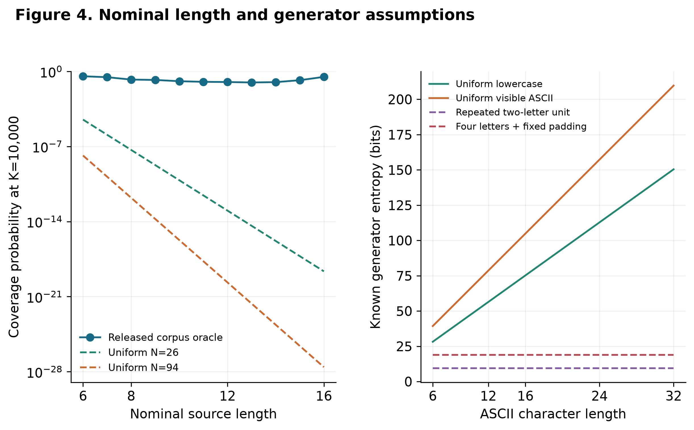

<div align="center">

# Password Length & Frequency Concentration

### A reproducible, aggregate-only reanalysis with controlled generation baselines

**What does password length tell us about frequency concentration—and what can’t it tell us?**

[Manuscript (Pages)](paper/submission/Imran_Zakirov_Password_Length_Manuscript.pages) ·
[DOCX](paper/submission/Imran_Zakirov_Password_Length_Manuscript.docx) ·
[PDF](paper/submission/Imran_Zakirov_Password_Length_Manuscript.pdf)

The portable editions include the manuscript text, tables, and figures. Pagination and some layout details may differ from the editable Pages source.


</div>

---

This repository studies **released password-frequency spectra**, not individual passwords or real-world cracking success. It combines a secondary analysis of historical, privacy-sanitized frequency releases with mathematical baselines, controlled synthetic generators, and a descriptive local verifier-cost experiment.

<p align="center">
  
</p>

<p align="center"><sub>Equal nominal length can describe different generation distributions. The human-frequency comparison uses a historical aggregate release; the generator controls are explicit mathematical models, not a matched human-versus-random attack trial.</sub></p>

## What the analysis finds

The main LinkedIn release contains 64 source-defined length groups. For the primary range, lengths 6–16, the estimated association between length and released frequency changes with the weighting: the weighted Spearman coefficient is **−0.335** under Account Mass weighting and **+0.041** under Distinct Anonymous Bin weighting. These are two descriptive views of the same released histogram, not population estimates.

Coverage is also non-monotonic across length groups. Under a per-length frequency oracle with a budget of 10,000 guesses, the released coverage is **35.65%** at length 6, **9.39%** at length 13, and **31.09%** at length 16. The oracle assumes the source-defined length and within-group frequency order are known; it does not represent an operational attack.

The study does **not** estimate how people choose passwords, test causal effects of length policies, or validate an operational guessing model. The available aggregate releases do not retain the identities or structural features needed for those questions.

## Study design

- **Historical aggregates:** LinkedIn frequency release v2 and Yahoo frequency release v1. The Yahoo release is a separate overall-concentration comparator; it has no length covariate and is not a replication of the length analysis.
- **Weighting:** Account Mass weights a frequency bin by frequency × multiplicity; Distinct Anonymous Bin weighting uses multiplicity. Ties are retained and fractional top-*K* coverage is used.
- **Sensitivity:** Adjacent lengths, tail restrictions, tie bounds, threshold grids, and differential-privacy perturbation are reported as exploratory aggregate diagnostics.
- **Controlled generators:** Uniform alphabet draws, fixed transformations, and EFF-word passphrases illustrate how specified generation rules change support and entropy at equal nominal length.
- **Verifier costs:** Existing local measurements cover PBKDF2, Argon2id, and bcrypt configurations. They are descriptive single-host timings, not attacker-throughput estimates.

There are no participant-level *p*-values or sampling confidence intervals for these released histograms. The length-model and long-threshold extensions are exploratory; human structural data and operational guessers remain unavailable or not run.

## Repository map

| Path | Contents |
| --- | --- |
| `src/` | Core histogram and analysis routines |
| `experiments/` | Reproduction, sensitivity, model, figure, and audit scripts |
| `data/raw/` | Public source archives, source metadata, EFF vocabulary, and the fixed illustrative HIBP snapshot |
| `data/derived/` | Anonymous frequency aggregates and synthetic feature summaries |
| `results/tables/` | Main and supplementary numerical outputs |
| `results/statistics/` | Run metadata, audits, manifests, and reproduction records |
| `results/figures/` | Original analysis figures |
| `results/journal_figures/` | Final main and appendix figures in PNG, PDF, and SVG |
| `paper/submission/` | Editable Pages manuscript and portable DOCX/PDF editions |

## Reproduce the analysis

The analysis uses Python 3.12. The pinned environment is in `requirements.lock`.

```bash
python3 -m venv .venv
source .venv/bin/activate
python -m pip install -r requirements.lock
```

The LinkedIn ZIP is excluded from Git by the repository’s ignore rules. Download the public, checksum-verified aggregate input before running the offline reproduction:

```bash
curl -L https://ndownloader.figshare.com/files/14027465 \
  -o data/raw/linkedin.zip
echo "fc831d2e524913d4692c297a356018f15a75d2a56520fc66576ddff0004faba7  data/raw/linkedin.zip" \
  | shasum -a 256 -c
```

Then run:

```bash
python experiments/reproduce.py
```

The reproduction script runs the project checks, rebuilds numerical outputs and figures from the frozen inputs, and compares table digests. It preserves the saved verifier timings rather than rerunning them. To skip figure generation, use `python experiments/reproduce.py --without-figures`.

## Data, privacy, and attribution

The LinkedIn and Yahoo archives contain anonymous frequency histograms released with differential-privacy sanitization; they are not credential dumps. The HIBP file is a frozen snapshot for eight public illustrative examples. The EFF Long Wordlist is retained unchanged and attributed under CC BY 4.0. Data provenance, file hashes, source terms, and the limits of each release are documented in [`data/README.md`](data/README.md).

These historical releases do not represent all users or current password practice. Anonymous frequency bins cannot be treated as identified passwords, independent people, or exact recovery events. Do not interpret oracle coverage as observed compromise, global guess rank, or evidence of a causal benefit from adding characters.

## License

Source code is available under the [MIT License](LICENSE). The manuscript, reports, and figures are licensed under [CC BY 4.0](https://creativecommons.org/licenses/by/4.0/), subject to the terms of third-party material listed in the repository license and data inventory.
